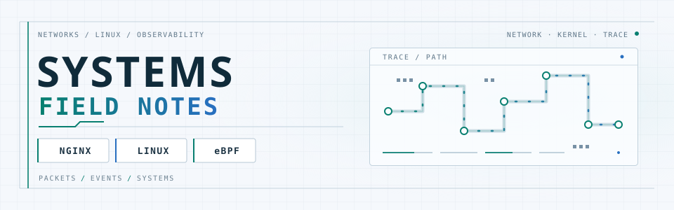

<picture>
  <source media="(prefers-reduced-motion: reduce)" srcset="./assets/hero-static.svg">
  <source media="(prefers-color-scheme: dark)" srcset="./assets/hero-dark.gif">
  <source media="(prefers-color-scheme: light)" srcset="./assets/hero-light.gif">
  
</picture>

<p align="center">
  <strong>读源码，追踪问题，把经验写成笔记。</strong><br>
  <sub>Systems · Observability · AI Engineering</sub>
</p>

<p align="center">
  <a href="https://weeweetan.github.io/">技术博客 ↗</a> &nbsp; · &nbsp;
  <a href="https://weeweetan.github.io/2024/03/09/BPF之巅学习笔记/">BPF 学习笔记 ↗</a> &nbsp; · &nbsp;
  <a href="https://github.com/weeweetan?tab=repositories">全部仓库 ↗</a>
</p>

### `01` / 关注的方向

```text
$ cat focus.conf

proxy    Nginx · OpenResty
trace    eBPF · bpftrace · perf
system   Linux · VMware vSphere
build    Python · Shell · AI-Native
```

从一次请求经过的代理模块，到内核中的事件与调用栈：记录 **Nginx、Linux、BPF** 的学习和排查过程，也探索 AI Agent 如何融入可验证的研发流程。

### `02` / 项目与工具

<table>
  <tr>
    <td>
      <h3><a href="https://github.com/weeweetan/ai-native-sdlc-framework">AIN-Loop</a> <sub> / AI-Native SDLC Framework</sub></h3>
      <p>面向 AI Agent 的研发流程框架：用可追溯工件、风险门禁和验证证据，连接计划、实现与交付。</p>
      <p><code>Python</code> <code>AI Agents</code> <code>工程实践</code></p>
    </td>
  </tr>
  <tr>
    <td>
      <h3><a href="https://github.com/weeweetan/LinuxNote">LinuxNote</a> <sub> / 系统工具箱</sub></h3>
      <p>整理 Linux 命令、系统观察工具和 Bash 脚本，积累能反复查阅的学习笔记。</p>
      <p><code>Linux</code> <code>Shell</code> <code>系统排障</code></p>
    </td>
  </tr>
  <tr>
    <td>
      <h3><a href="https://github.com/weeweetan/VMwareProject">VMwareProject</a> <sub> / vSphere SDK 示例</sub></h3>
      <p>整理 vSphere Management SDK 示例与 IDEA 编译运行方法，验证范围见仓库说明。</p>
      <p><code>Java</code> <code>VMware vSphere</code> <code>SDK Samples</code></p>
    </td>
  </tr>
</table>

### `03` / 从笔记开始

- **[Nginx 模块与请求处理](https://weeweetan.github.io/categories/Nginx/)** — 缓存、限流、反向代理与模块代码。
- **[BPF 之巅学习笔记](https://weeweetan.github.io/2024/03/09/BPF之巅学习笔记/)** — 从观测点、工具选择到 CPU、内存、I/O 排查。
- **[Linux 学习记录](https://weeweetan.github.io/categories/Linux/)** — 常用命令、环境搭建与问题记录。
- **[订阅更新 · Atom](https://weeweetan.github.io/atom.xml)** — 在阅读器里继续追踪。

### `04` / GitHub 活动

<picture>
  <source media="(prefers-color-scheme: dark)" srcset="./profile/stats-dark.svg">
  <source media="(prefers-color-scheme: light)" srcset="./profile/stats.svg">
  
</picture>
<picture>
  <source media="(prefers-color-scheme: dark)" srcset="./profile/top-langs-dark.svg">
  <source media="(prefers-color-scheme: light)" srcset="./profile/top-langs.svg">
  
</picture>

<sub>统计卡由 GitHub Actions 更新；语言分布反映仓库代码量。</sub>

---

<p align="center"><sub>Read the source. Follow the trace. Keep the notes.</sub></p>
